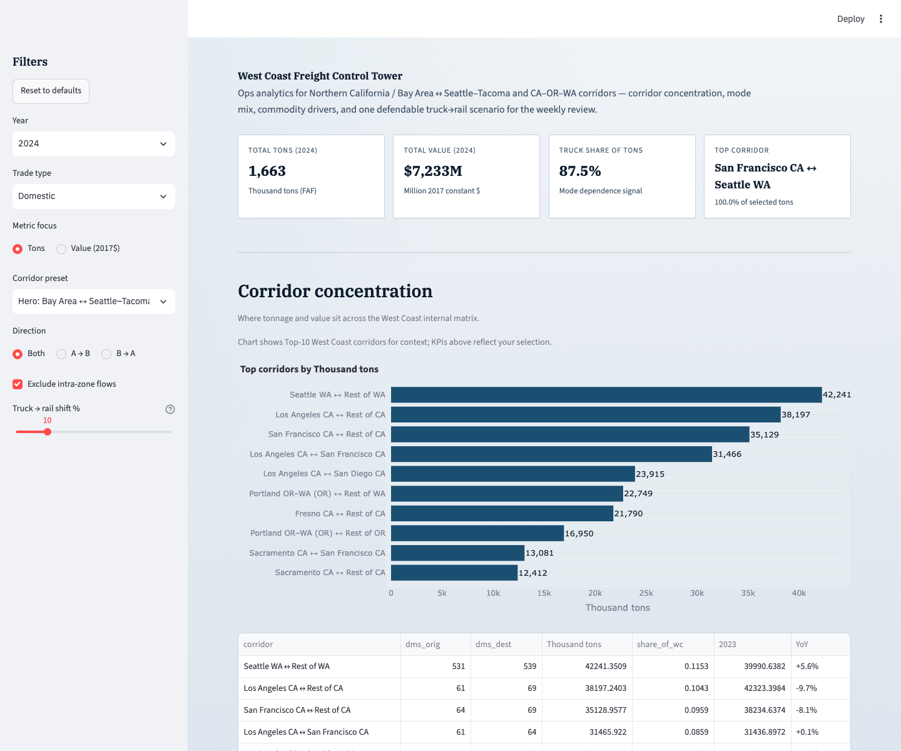

# West Coast Freight Control Tower

**Ops analytics for Bay Area ↔ Seattle–Tacoma and CA–OR–WA corridors** — where tonnage and value concentrate by corridor, mode, and commodity, and what a simple truck→rail shift does to mode mix.

Built for a logistics / supply-chain **Business Analyst or Ops Analytics** stakeholder who needs a weekly review pack — not a national freight atlas.



## 60-second brief

1. **Question:** Where is West Coast freight concentrated by corridor / mode / commodity, and what happens if a share of truck tons shifts to rail?
2. **Data:** BTS/FHWA **FAF5.7.1** regional ODCM, annual **2018–2024**, FAF domestic zones (not county). Units: thousand tons · million 2017$ · million ton-miles.
3. **Top findings (domestic WC, 2024):**
   - Concentration sits first in **metro ↔ remainder-of-state** corridors (e.g. Seattle↔Rest of WA, LA↔Rest of CA, Bay↔Rest of CA).
   - **Truck** moves ~**64%** of selected WC tons; pipeline ~28%; rail only ~**3%**. The Bay↔SeaTac hero corridor is ~**88% truck**.
   - **Tons vs value reorders:** coal & petroleum products n.e.c. lead tons; mixed freight / pharmaceuticals / electronics lead value.
4. **Scenario slider:** reassigns `p%` of **truck tons → rail** on the current selection (default 10%, max 50%). Instantaneous tonnage only — **no** capacity, cost, transit time, or diverted OD.
5. **Deliberately cut:** maps, FAF6 dual-support, forecasts 2030–2050, county files, cost/emissions/ML, national explorer.

## How to run

```bash
git clone https://github.com/akshay-bhatkhande/west-coast-freight-control-tower.git
cd west-coast-freight-control-tower
python -m venv .venv
source .venv/bin/activate   # Windows: .venv\Scripts\activate
pip install -r requirements.txt
python scripts/download_faf.py    # ~184 MB zip; cached after first run
python scripts/build_tables.py
pytest
streamlit run app/Home.py
```

Open the local URL Streamlit prints (usually `http://localhost:8501`).

## What’s in the app

| Section | Purpose |
| --- | --- |
| KPI strip | Tons, value, truck share, top corridor |
| Corridor concentration | Top-10 OD + YoY |
| Mode mix | Shares for the active selection |
| Commodity mix | Top SCTG2 (tons or value) |
| Mode-shift scenario | Truck→rail slider + before/after |
| Weekly Ops Review | Auto markdown brief + download |
| Data & methods | Grain, units, limitations |

## Data & citation

- **Source:** [BTS FAF](https://www.bts.gov/faf) / ORNL FAF5 — `FAF5.7.1_2018-2024.zip`
- **DOI:** https://doi.org/10.21949/1529116
- **Public domain** U.S. Government work. Cite BTS/FHWA FAF5.
- Full field definitions: [`docs/data-dictionary.md`](docs/data-dictionary.md)

Raw CSV/zip are **gitignored**. Lookups under `data/lookups/` are committed.

## Project layout

```text
app/Home.py            # Streamlit entry
src/{config,etl,kpis,brief}.py
scripts/download_faf.py
scripts/build_tables.py
tests/                 # fixture unit tests + optional integration
docs/                  # data-dictionary, decisions, build-log
```

## Limitations (say these aloud)

- FAF is a **modeled regional estimate**, not facility-level shipment tickets.
- **“Weekly”** = briefing cadence for ops — FAF itself is **annual** (2024 preliminary).
- Scenario is a **discussion tool**, not a network plan.

## Build honesty

AI assisted scaffolding, ETL, and UI iteration. KPI definitions, cut list, and stakeholder framing were validated against the frozen BTS/FAF research spec. See [`docs/build-log.md`](docs/build-log.md) and [`docs/decisions.md`](docs/decisions.md).

## License

Code: [MIT](LICENSE). Data: U.S. Government public domain (FAF).
